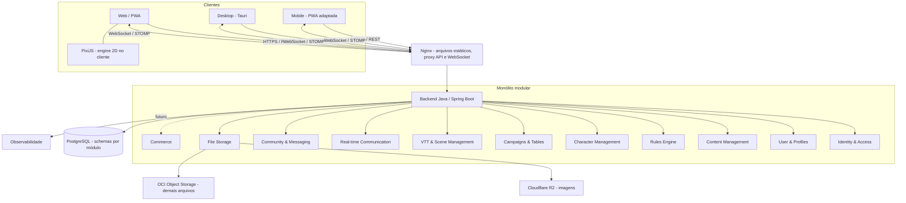
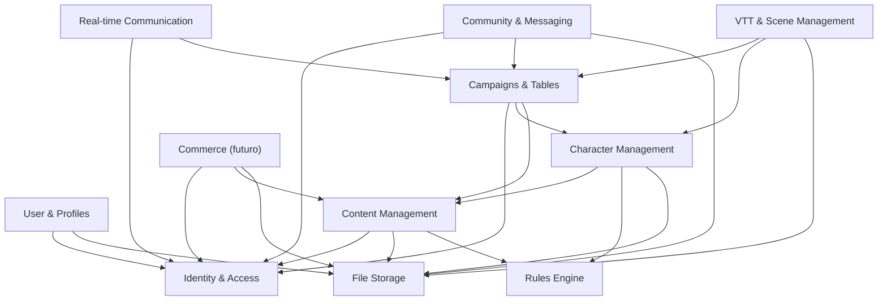

# Evolution VTT — Blueprint Arquitetural
## Documentação Técnica de Referência

| Campo | Valor |
|---|---|
| Projeto | Evolution VTT |
| Documento | Blueprint Arquitetural |
| Identificador | EVTT-BP-001 |
| Versão | 1.0.0 |
| Data | 20/11/2026 |
| Estado | Baseline arquitetural consolidada |
| Repositório | https://github.com/Rafalerio/EvolutionVTT |

---

## Controle do documento

### Objetivo

Este documento consolida a arquitetura de referência do Evolution VTT e estabelece diretrizes para implementação, evolução e operação. Deve ser utilizado como referência por desenvolvedores, agentes de IA, revisores de código e responsáveis pela infraestrutura.

### Estado e interpretação

- As ADRs 001–014 estão aprovadas.
- Os modelos C4-001 a C4-004 estão aprovados.
- O C4-005 foi aprovado integralmente pelo responsável pelo projeto.
- Detalhamentos ainda não especificados são identificados como **pendentes de definição**, não como decisões implícitas.
- Este documento consolida decisões já tomadas; não substitui ADRs individuais nem autoriza alterar silenciosamente decisões aprovadas.
- Quando uma implementação exigir uma decisão arquitetural nova ou modificar uma decisão aprovada, deverá ser criada ou atualizada uma ADR.

### Hierarquia de referência

Em caso de divergência, aplicar a seguinte ordem:
1. ADR aprovada mais recente para a decisão arquitetural específica.
2. Modelo C4 aprovado e seus refinamentos aprovados.
3. Este Blueprint, que consolida e referencia os anteriores.
4. Documentação inicial e requisitos originais, quando não substituídos por decisões posteriores.
5. Implementação existente, que não deve ser considerada automaticamente correta apenas por já existir.

---

# 1. Visão do produto

O Evolution VTT é uma plataforma de Virtual Tabletop voltada inicialmente ao RPG Evolution, com arquitetura preparada para suportar sistemas de regras configuráveis e conteúdos oficiais ou criados pela comunidade.

A plataforma reúne:
- gestão de contas, perfis e permissões;
- catálogo, organização, autoria, publicação e moderação de conteúdos;
- motor de regras configurável;
- criação, manutenção e utilização de fichas;
- mesas virtuais e diretórios de recursos;
- cenas, mapas, tokens e ferramentas gráficas;
- comunicação em tempo real;
- comunicação comunitária;
- armazenamento de arquivos;
- comércio e licenciamento em fase futura.

A experiência será disponibilizada por clientes Web/PWA, Desktop e Mobile, compartilhando a mesma plataforma de serviços e os mesmos contratos. As interfaces poderão ser adaptadas às capacidades de cada dispositivo.

## 1.1 Objetivos arquiteturais

1. Tornar a plataforma extensível sem acoplar regras de RPG à interface ou à infraestrutura.
2. Preservar consistência e autoridade do backend sobre regras, permissões e estado oficial das mesas.
3. Permitir evolução incremental, começando por um produto utilizável e ampliando capacidades sem reescrita estrutural.
4. Manter módulos com responsabilidades e propriedade de dados claras.
5. Permitir que agentes e equipes implementem módulos com baixo risco de interferência.
6. Automatizar build, testes, validações, publicação e implantação.
7. Sustentar crossplay entre Web, Desktop e Mobile.
8. Preparar comércio, moderação, segurança e escala sem exigir sua implementação integral no primeiro lançamento.

## 1.2 Princípios do produto

- **Versatilidade:** regras e conteúdos não devem ficar hardcoded em componentes de interface.
- **Simplicidade de uso:** fluxos devem reduzir a carga operacional de mestres e jogadores.
- **Extensibilidade:** novos sistemas, conteúdos, ferramentas e clientes devem ser adicionáveis por contratos definidos.
- **Compatibilidade:** clientes diferentes devem operar sobre a mesma fonte oficial de estado.
- **Evolução progressiva:** funcionalidades avançadas serão introduzidas quando houver necessidade real.

---

# 2. Escopo e limites

## 2.1 Escopo funcional arquitetural

| Domínio | Responsabilidade geral |
|---|---|
| Identidade e acesso | Contas, credenciais, autenticação, sessões, dispositivos e papéis globais |
| Perfis | Identidade pública, preferências, privacidade e avatar |
| Conteúdo | Catálogo, organização, autoria, homebrew, revisão, publicação e versões |
| Regras | Definição, validação, compilação e execução de regras |
| Personagens | Fichas, versões, progressão, instâncias contextuais e histórico |
| Mesas | Salas, participantes, permissões, diretório e associações |
| VTT | Cenas, mapas, tokens, objetos, visibilidade e estado gráfico |
| Tempo real | Conexões, canais, autorização de inscrições, distribuição e recuperação |
| Comunidade | Mensagens, fóruns, avisos, moderação e histórico |
| Arquivos | Upload, validação, metadados, provedores e ciclo de vida |
| Comércio | Produtos, pedidos, pagamentos, licenças e direitos comerciais; futuro |

## 2.2 Fora do primeiro lançamento

Os itens abaixo são previstos arquiteturalmente, mas não são pré-requisitos para o primeiro lançamento:
- comércio completo e processamento de pagamentos;
- mapas 3D animados;
- execução de scripting arbitrário fornecido por usuários;
- microsserviços;
- Kubernetes;
- sincronização offline avançada;
- sistema completo de Fog of War, salvo priorização posterior;
- broker de mensagens externo;
- cliente mobile nativo, enquanto PWA atender às necessidades.

## 2.3 Evolução da VTT

A VTT será construída progressivamente:
1. mapas, tokens, rolagens, chat, medidas, desenhos e formas;
2. recursos de VTT mais completos, ampliando a experiência de mesa;
3. funcionalidades avançadas, incluindo possibilidades 3D em etapa futura.

---

# 3. Atores e modelo de acesso

A plataforma considera os seguintes atores:
- **Visitante:** consulta conteúdos públicos e gratuitos sem necessariamente possuir conta.
- **Jogador:** participa de mesas, mantém personagens e pode criar/publicar homebrews conforme as políticas de moderação.
- **Mestre:** administra mesas, participantes, permissões, cenas e recursos da mesa.
- **Moderador:** exerce permissões de revisão e moderação de conteúdo comunitário.
- **Administrador:** exerce funções administrativas globais autorizadas.

Um usuário não precisa possuir uma categoria global exclusiva para ser criador de homebrew. A capacidade de criar conteúdo é uma permissão/funcionalidade associada à conta e às políticas aplicáveis.

Papéis globais não substituem permissões contextuais. Um usuário pode ser mestre em uma mesa e jogador em outra. A autorização de uma ação contextual deve ser validada pelo módulo proprietário do recurso ou contexto.

O Manual Base gratuito deve permanecer acessível publicamente. Conteúdos sujeitos a aquisição ou licença devem respeitar os direitos de acesso correspondentes.

---

# 4. Arquitetura geral

## 4.1 Estilo arquitetural

O sistema adota:
- monólito modular no backend;
- Clean Architecture e princípios de DDD;
- comunicação híbrida por contratos síncronos e eventos;
- PostgreSQL com schema por módulo;
- REST para operações request/response;
- WebSocket com STOMP para comunicação em tempo real;
- clientes React + Vite + TypeScript;
- PixiJS para renderização 2D;
- armazenamento de objetos por adaptadores;
- infraestrutura conteinerizada e provisionada como código.

Microsserviços não serão adotados inicialmente. A extração de um módulo para serviço independente somente deverá ocorrer quando houver justificativa mensurável de escala, isolamento, implantação, disponibilidade ou autonomia de equipe.

## 4.2 Diagrama lógico



## 4.3 Containers e unidades de implantação

Os containers C4 representam unidades lógicas de aplicação e não implicam, por si só, um container Docker para cada módulo.

A implantação inicial poderá agrupar:
- Nginx;
- aplicação backend;
- PostgreSQL;
- componentes de observabilidade necessários;
- serviços auxiliares definidos na configuração do ambiente.

Os módulos de negócio permanecem dentro do processo do monólito modular.

---

# 5. Arquitetura do backend

## 5.1 Módulos

O backend é dividido nos seguintes módulos:

1. `identity-access`
2. `user-profiles`
3. `content-management`
4. `rules-engine`
5. `character-management`
6. `campaigns-tables`
7. `vtt-scene-management`
8. `real-time-communication`
9. `community-messaging`
10. `file-storage`
11. `commerce` (futuro)

Os nomes acima são identificadores arquiteturais. O padrão definitivo de nomes de pacotes Java deverá ser aplicado consistentemente no repositório.

## 5.2 Estrutura interna

A organização padrão de cada módulo contempla:

- **Application:** casos de uso, comandos, consultas, orquestração e coordenação.
- **Domain:** entidades, agregados, objetos de valor, políticas, invariantes e eventos de domínio.
- **Ports / Contracts:** interfaces de entrada e saída, contratos públicos e dependências abstratas.
- **Infrastructure / Adapters:** persistência, integrações externas, mensageria e implementações técnicas.

Nem todos os módulos precisam possuir exatamente os mesmos diretórios. A estrutura deve refletir responsabilidades reais e não criar abstrações sem necessidade.

## 5.3 Regras de dependência

1. Um módulo não importa pacotes internos de outro módulo.
2. Um módulo não acessa diretamente tabelas, entidades JPA ou repositórios pertencentes a outro módulo.
3. Integrações ocorrem por contratos públicos e eventos.
4. Contratos expõem apenas os dados necessários ao consumidor.
5. Dependências entre módulos são lógicas e não exigem chamadas REST internas.
6. O domínio não depende de Spring, WebSocket/STOMP, PixiJS ou provedores de armazenamento.
7. O transporte RTC não é dependência de domínio dos módulos de negócio.
8. Dependências circulares são proibidas.
9. Testes arquiteturais devem validar as fronteiras na CI.

## 5.4 Grafo de dependências de domínio



O diagrama representa dependências lógicas por contratos. A comunicação de RTC com VTT e Community & Messaging para distribuição de eventos ocorre por interfaces/eventos internos, sem transformar RTC em proprietário de dados de domínio.

## 5.5 Orquestração

Operações que envolvem mais de um módulo são coordenadas por casos de uso na camada de aplicação. Não será criado um orquestrador central genérico.

Cada operação composta deve:
- ter um responsável de aplicação identificável;
- declarar os módulos participantes;
- definir ordem e pré-condições;
- ser idempotente quando puder ser repetida;
- tratar falhas parciais;
- prever compensação quando aplicável;
- usar Outbox para eventos duráveis quando necessário.

---

# 6. Responsabilidades dos módulos

## 6.1 Identity & Access

Responsável por:
- contas e identificadores;
- credenciais;
- autenticação;
- sessões e dispositivos;
- papéis globais;
- segurança e revogação.

Decisões:
- `AccountId` é imutável e independente do e-mail.
- E-mail pode mudar sem alterar `AccountId`; deve ser verificado antes de ser considerado confirmado.
- Conta, credencial, sessão e dispositivo são conceitos separados.
- Um dispositivo pode possuir várias sessões.
- O usuário pode revogar uma sessão específica ou todas as sessões.
- Evolution VTT é autoridade central de identidade e emissora OIDC, com possibilidade futura de provedores externos.
- Senhas usam Argon2id.
- Access tokens têm curta duração; refresh tokens usam rotação e revogação.
- Reutilização de refresh token deve ser detectável.
- Suspensão de conta invalida autenticação conforme política de segurança.

Schema: `identity_access`.

Eventos definidos: `AccountRegistered`, `AccountActivated`, `AccountSuspended`, `AccountReactivated`, `CredentialsChanged`, `AuthenticationRevoked`, `SessionCreated`, `SessionRevoked`, `GlobalRoleAssigned`, `GlobalRoleRemoved`.

Pendências: duração exata dos tokens, limites de tentativas, bloqueios e retenção de logs.

## 6.2 User & Profiles

Responsável por:
- perfil público;
- preferências;
- identidade pública;
- privacidade do perfil;
- avatar;
- integração com identidade.

Identity & Access é a autoridade sobre conta e autenticação. User & Profiles não replica credenciais.

## 6.3 Content Management

Responsável por:
- catálogo de conteúdo;
- hierarquia de livros, capítulos e seções;
- metadados e etiquetas;
- relações entre conteúdos;
- autoria e edição;
- homebrews;
- revisão e moderação;
- publicação e controle de acesso;
- versionamento.

A organização de conteúdo é híbrida:
- hierarquia organiza a apresentação;
- metadados e etiquetas apoiam descoberta;
- relacionamentos conectam materiais.

Conteúdos publicados são imutáveis. Uma alteração gera nova versão. Mesas referenciam versões explícitas. Migrações exigem operação explícita e aprovação do responsável.

O Manual Base é gratuito e público. Direitos de conteúdos licenciados devem ser verificados pelos módulos responsáveis por acesso e, futuramente, Commerce.

## 6.4 Rules Engine

Responsável por:
- modelo de definição de regras;
- parsing;
- validação estrutural e semântica;
- compilação;
- interpretação/execução;
- operações centrais;
- contexto de execução;
- aleatoriedade;
- limites de segurança;
- extensões confiáveis.

A linguagem será uma DSL declarativa própria, com AST como representação canônica e representação intermediária interna para execução.

Níveis de evolução:
- **A:** aritmética, dados, variáveis, referências, comparações e funções predefinidas.
- **B:** regras compostas, efeitos, dependências e extensões controladas.
- **C:** extensões avançadas e scripting controlado, somente após ADR específica.

Regras devem ser validadas e compiladas antes de publicação/execução. A execução é determinística dado o contexto e os resultados aleatórios registrados. Não há execução arbitrária de código de usuários no núcleo.

Limites devem contemplar profundidade da AST, operações, tempo, memória, iterações e referências. O motor não recebe acesso arbitrário a rede, arquivos ou sistema operacional.

Schema: `rules_engine`.

O Rules Engine fornece mecanismos técnicos; Content Management permanece proprietário do ciclo editorial e publicação dos conteúdos.

## 6.5 Character Management

Responsável por:
- personagens originais;
- modelo de dados da ficha;
- definições de ficha e compatibilidade;
- progressão;
- versionamento;
- instâncias contextuais;
- modificações locais;
- histórico;
- cálculos;
- ativos associados.

Decisões:
- personagens pertencem à conta criadora;
- `AccountId` do personagem é estável;
- transferência explícita poderá ser contemplada futuramente;
- ficha combina núcleo tipado estável e extensões configuráveis em JSONB;
- extensões são validadas pela definição versionada;
- alterações relevantes geram nova versão lógica;
- histórico é imutável;
- restauração é uma nova operação auditável;
- definição de ficha é referenciada por versão específica e imutável.

Instâncias contextuais:
- `frozen`: snapshot da ficha no momento da vinculação;
- `local`: instância editável localmente pelo mestre, sem alterar o original ou outras mesas.

Character Management é proprietário das fichas, instâncias e histórico. Campaigns & Tables é proprietário do vínculo e do contexto/autorização.

Schema: `character_management`.

Eventos definidos: `CharacterCreated`, `CharacterUpdated`, `CharacterVersionCreated`, `CharacterProgressionApplied`, `CharacterInstanceCreated`, `CharacterInstanceModified`, `CharacterInstanceDetached`, `CharacterAssetAssociated`, `CharacterAssetRemoved`, `CharacterCalculationCompleted`.

## 6.6 Campaigns & Tables

Responsável por:
- mesas como salas de interação;
- participantes;
- convites;
- permissões contextuais;
- diretório de recursos;
- organização hierárquica;
- vínculos e cópias;
- associações de personagens, conteúdos e cenas;
- cena ativa compartilhada.

Uma mesa não exige modelagem obrigatória de campanha, aventura ou narrativa.

O diretório contém somente:
- fichas de personagens;
- fichas de NPCs;
- mapas.

A biblioteca é hierárquica. Cada recurso pertence a uma única pasta por vez.

Permissões:
- o mestre administra a mesa e concede permissões;
- o jogador padrão `view_add` pode visualizar e adicionar/vincular seus próprios recursos;
- o jogador padrão não edita recursos compartilhados, organiza pastas, remove recursos da mesa nem gerencia permissões.

Vínculo e cópia:
- recurso pode ser vinculado ou copiado;
- cópia é lógica e completamente independente;
- deduplicação física é permitida se não comprometer independência lógica;
- NPC criado no diretório pertence à mesa e é editado pelo mestre;
- mapas podem ser utilizados em várias cenas;
- ficha original vinculada gera instância contextual `frozen` no momento da vinculação; o mestre pode optar por `local`.

Campaigns & Tables é proprietário da associação de cenas à mesa e da cena ativa compartilhada. VTT & Scene Management é proprietário dos dados e do ciclo de vida das cenas.

Schema: `campaigns_tables`.

## 6.7 VTT & Scene Management

Responsável por:
- cenas;
- configuração de cena;
- integração de mapas;
- tokens;
- controle de tokens;
- objetos de cena;
- desenhos e medidas;
- visibilidade;
- estado e snapshots;
- integração com renderização.

Modelo:
- uma mesa possui várias cenas;
- cada cena pertence a uma mesa;
- um mapa pode ser usado por várias cenas;
- tokens são instâncias visuais independentes;
- tokens podem estar vinculados a ficha contextual ou ser independentes;
- cena contém tokens e objetos livres;
- mestre administra cenas por padrão e controla visibilidade;
- elementos ocultos devem ser filtrados no backend;
- Fog of War é evolução futura.

Tokens:
- atributos herdados são snapshot no momento da criação;
- token possui estado próprio;
- no máximo um jogador é atribuído a cada token;
- token pode não ter jogador atribuído;
- mestre controla todos os tokens;
- jogador controla movimentação e rotação do token atribuído;
- aparência, tamanho, nome, barras, marcadores, visibilidade e exclusão são controlados pelo mestre, salvo permissões futuras.

Movimentação:
- pré-visualização pode ser contínua;
- posição final deve aplicar snap obrigatório à grade;
- grades quadrada e hexagonal;
- calibração de grade por cena;
- coordenadas persistidas em world space, independentes de pixels, grade e tela;
- unidade espacial é abstrata;
- estado persistido/autoritativo usa precisão numérica em ponto fixo, escala ainda a definir;
- limites de mundo são configuráveis por cena e distinguem limite de movimentação e de renderização.

Concorrência:
- backend é autoridade do estado oficial;
- prioridade do mestre é aplicada pelo servidor;
- comandos devem validar revisão e impedir aplicação de comandos antigos ou duplicados;
- alterações relevantes são persistidas;
- cursor, seleção, pré-visualização e arraste podem ser transitórios.

Exclusão de cena: mestre pode arquivar ou excluir definitivamente.

## 6.8 Real-time Communication

Responsável por:
- conexões;
- autenticação da conexão;
- canais;
- autorização de inscrições;
- distribuição de eventos;
- sincronização;
- comunicação transitória;
- recuperação de conexão.

Tecnologia: WebSocket + STOMP.

Decisões:
- servidor autoritativo;
- sem broker externo inicialmente;
- arquitetura preparada para broker futuro;
- recuperação por snapshot do estado atual;
- autorização por mesa em conexões e inscrições;
- eventos importantes são persistidos pelo módulo proprietário;
- atualizações transitórias podem não ser persistidas;
- RTC não é proprietário dos dados de domínio.

## 6.9 Community & Messaging

Responsável por:
- mensagens diretas;
- mensagens de mesa;
- fóruns;
- avisos;
- conteúdo comunitário;
- moderação;
- anexos;
- histórico de mensagens.

RTC transporta e distribui; Community & Messaging é proprietário do conteúdo e histórico de comunicação.

## 6.10 File Storage

Responsável por:
- registro e metadados;
- validação;
- seleção de provedor;
- adaptadores;
- upload/download;
- referências;
- limpeza de órfãos;
- políticas de armazenamento.

Provedores:
- Cloudflare R2 para todas as imagens em produção;
- OCI Object Storage para documentos, anexos, exportações/importações e arquivos não classificados como imagens;
- armazenamento local para desenvolvimento e testes.

O módulo expõe interface comum e adaptadores independentes. Módulos de negócio validam autorização; File Storage não decide permissões de domínio.

Upload:
- upload direto ao provedor por URL assinada;
- backend inicia e conclui o fluxo;
- arquivo permanece em quarentena até validação;
- URLs assinadas limitadas por escopo e validade;
- exclusão lógica seguida de remoção física assíncrona;
- deduplicação física permitida sem comprometer independência lógica.

Ciclo de vida:
`PENDING_UPLOAD` → `UPLOADED` → `VALIDATING` → `AVAILABLE`

Fluxos alternativos:
- `VALIDATING` → `QUARANTINED`;
- `AVAILABLE` → `PENDING_DELETION` → `DELETED`.

Validar tamanho, extensão e conteúdo real. Classificar pelo conteúdo validado e política, não apenas pela extensão informada. Prevenir arquivo malicioso disfarçado de imagem. Registrar integridade, MIME, tamanho, proprietário, permissões, provedor e chave.

Schema: `file_storage`.

Eventos definidos: `FileUploadInitiated`, `FileUploaded`, `FileValidated`, `FileAvailable`, `FileQuarantined`, `FileDeletionRequested`, `FileDeleted`, `FileIntegrityCheckFailed`.

A compatibilidade real de APIs S3, custos e egress de R2/OCI devem ser verificados durante implementação.

## 6.11 Commerce (futuro)

Responsável futuramente por:
- catálogo comercial;
- preços;
- pedidos;
- compras;
- integração de pagamentos;
- licenças;
- direitos de acesso;
- histórico transacional;
- referências de arquivos comerciais.

Commerce é proprietário de pedidos, compras, pagamentos, licenças e direitos comerciais. Content Management é proprietário de conteúdos, versões e publicações.

O módulo deve ser planejado por contratos, sem ser requisito para o primeiro lançamento.

---

# 7. Contratos, eventos e integração

## 7.1 Tipos de integração

A integração entre módulos combina:
- contratos síncronos para consultas ou operações que exigem resposta imediata;
- eventos para notificar mudanças;
- orquestração de casos de uso para operações compostas;
- Outbox para publicação durável quando necessário;
- RTC para transporte e atualizações transitórias.

## 7.2 Regras para contratos

- Contratos públicos devem ser explícitos e versionados.
- Não expor entidades internas completas.
- DTOs devem representar necessidades do consumidor.
- Contratos devem declarar semântica de erro e autorização.
- Mudanças incompatíveis exigem estratégia de versão/migração.
- Testes de contrato devem validar produtores e consumidores.

## 7.3 Eventos

Eventos de domínio representam fatos relevantes dentro do domínio de um módulo. Eventos de integração são contratos destinados a outros módulos. Não tratar os dois conceitos como automaticamente idênticos.

Eventos duráveis devem usar Outbox quando houver risco de perda entre commit de banco e publicação. Eventos transitórios de interação não precisam ser persistidos indiscriminadamente.

## 7.4 Idempotência e falhas

Operações repetíveis devem definir chave ou regra de idempotência. Integrações compostas devem prever:
- timeout;
- falha parcial;
- repetição segura;
- compensação;
- reconciliação;
- rastreabilidade por identificador de correlação.

---

# 8. Persistência e dados

## 8.1 Banco de dados

- PostgreSQL.
- Schema por módulo.
- Spring Data JPA + Hibernate.
- Flyway.
- Constraints e transações ACID.
- JSONB para estruturas configuráveis quando justificado.
- Dados centrais, identificadores, estados e invariantes devem permanecer relacionais/estruturados.

Schemas aprovados:
- `identity_access`
- `file_storage`
- `rules_engine`
- `character_management`
- `campaigns_tables`

Os schemas restantes deverão seguir o padrão do módulo correspondente; nomes finais devem ser fixados no blueprint de persistência e no código.

## 8.2 Propriedade de dados

Cada módulo é proprietário de seus dados. Não utilizar foreign keys entre schemas como mecanismo de integração. Não consultar tabelas de outro módulo diretamente.

Referências a identificadores de outros módulos são valores de contrato, não autorização para acessar suas tabelas.

## 8.3 Migrações

- Flyway centralizado.
- Migrations organizadas por módulo.
- Estratégia Expand/Contract.
- Migrações devem ser compatíveis com a versão de aplicação durante deploy progressivo.
- Migrations de produção devem ser controladas e documentadas.
- Rollback deve considerar que nem toda alteração de dados é reversível automaticamente.

## 8.4 Modelos de leitura

Consultas podem utilizar modelos de leitura específicos quando houver benefício claro. Não duplicar dados sem definir origem, atualização e consistência.

---

# 9. Frontend e experiência do cliente

## 9.1 Stack aprovada

- React;
- Vite;
- TypeScript;
- TanStack Query para estado remoto;
- Zustand para estado global/local compartilhado;
- React Hook Form;
- Zod;
- React Router;
- OpenAPI para integração e geração de tipos;
- Design System próprio.

## 9.2 Princípios

- Interface geral é React.
- Engine gráfica 2D é PixiJS.
- Modelo de cena é independente da engine.
- Interações gráficas são encapsuladas em camada própria.
- Domínio não depende da tecnologia de renderização.
- Componentes reutilizáveis e tokens semânticos devem preservar identidade visual.
- Interfaces podem variar por plataforma, mantendo contratos e serviços compartilhados.

Paleta visual de referência:
- `#6e0e0a`
- `#08415c`
- `#6b818c`
- `#f9f9ed`
- `#ffc857`

## 9.3 Estado no cliente

- TanStack Query: dados remotos, cache, invalidação e sincronização com API.
- Zustand: estado compartilhado de interface e estado local que precise ser acessado por múltiplos componentes.
- Formulários: React Hook Form + Zod.
- Tipos e clientes de API devem derivar de contratos OpenAPI sempre que possível.

Não duplicar indiscriminadamente estado remoto em Zustand.

---

# 10. Engine gráfica e modelo espacial

## 10.1 PixiJS

PixiJS é a engine 2D aprovada. Ela reside no cliente e não é serviço separado.

React controla a interface geral; PixiJS renderiza o espaço de jogo. A integração deve ocorrer por interfaces definidas.

## 10.2 Modelo de cena independente

O modelo de cena não deve depender de PixiJS. Deve representar:
- mapa;
- tokens;
- objetos;
- desenhos;
- medições;
- camadas;
- configurações;
- visibilidade;
- coordenadas.

A engine recebe o modelo e o renderiza. Interações do usuário geram comandos/intenções que passam pelas regras de autorização e validação do backend.

## 10.3 Coordenadas

Coordenadas persistidas usam world space, independentes de:
- resolução do mapa;
- zoom;
- viewport;
- escala de tela;
- configuração visual da grade.

A grade é uma política de cena e não a unidade de armazenamento espacial. A escala de ponto fixo e limites numéricos ainda precisam ser definidos em especificação técnica.

---

# 11. Comunicação em tempo real

## 11.1 Protocolo

WebSocket + STOMP.

## 11.2 Autoridade e autorização

O backend é autoridade sobre:
- participantes e permissões;
- comandos de cena;
- movimento final de tokens;
- visibilidade;
- estado compartilhado;
- inscrição em canais.

Autorização deve ser validada na conexão e em cada inscrição/canal pertinente. Não confiar em filtros de interface para proteger conteúdo.

## 11.3 Estado e recuperação

- Eventos relevantes alteram estado oficial e são persistidos pelo módulo proprietário.
- Eventos transitórios podem ser distribuídos sem persistência.
- Reconexão recupera estado por snapshot.
- Atualizações devem considerar revisão/versão do estado para evitar comandos obsoletos.
- A arquitetura deve permitir adoção futura de broker sem acoplar o domínio ao produto de mensageria.

---

# 12. Segurança

## 12.1 Identidade

- Spring Security.
- OAuth 2.1 / OpenID Connect.
- Evolution VTT como emissora central OIDC.
- Login por e-mail e senha.
- Argon2id.
- Access token de curta duração.
- Refresh token rotativo.
- Revogação de sessão e dispositivos.
- Recuperação de senha com token de uso único.

## 12.2 Autorização

Modelo combinado:
- RBAC para papéis globais;
- permissões contextuais por mesa, conteúdo e recurso;
- autorização validada pelo módulo proprietário.

O backend deve validar todas as operações protegidas, inclusive comandos enviados por WebSocket/STOMP.

## 12.3 Proteção de dados e arquivos

- Não registrar credenciais, tokens ou dados sensíveis em logs.
- URLs assinadas devem ter escopo e validade limitados.
- Arquivos suspeitos permanecem em quarentena.
- Validar conteúdo real, tamanho e tipo.
- Aplicar limites de upload e políticas de retenção.
- Proteger eventos e trilhas de auditoria.

## 12.4 Pendências de segurança

Definir tecnicamente:
- duração de access/refresh tokens;
- limites de tentativas de login;
- bloqueios e backoff;
- política de MFA, se adotada;
- retenção de logs e auditoria;
- requisitos de proteção de dados e privacidade por jurisdição;
- política de sessões e dispositivos.

---

# 13. Desktop, Mobile e crossplay

## 13.1 Desktop

Tauri é a tecnologia aprovada. A interface React/Vite/TypeScript é reutilizada. A camada Rust deve ficar restrita a integrações que exigem acesso ao sistema operacional.

Desktop utiliza os mesmos contratos de API, autenticação e STOMP.

Offline inicial é limitado a abrir a aplicação e consultar dados previamente armazenados. Não há compromisso inicial com sessões completas offline ou sincronização avançada.

## 13.2 Mobile

Estratégia PWA primeiro, com possibilidade futura de Capacitor ou React Native. A VTT mobile deve oferecer funcionalidades essenciais completas e simplificar ferramentas complexas.

Adoção de aplicativo nativo será reavaliada conforme limitações reais da PWA e necessidades observadas.

## 13.3 Crossplay

Web, Desktop e Mobile são clientes da mesma plataforma. Não manter fontes autoritativas separadas por cliente. Contratos, regras e serviços são compartilhados; interfaces podem ser adaptadas.

---

# 14. Armazenamento de arquivos

## 14.1 Provedores por categoria

| Categoria | Desenvolvimento/testes | Produção |
|---|---|---|
| Imagens | Local | Cloudflare R2 |
| Documentos e demais arquivos | Local | OCI Object Storage |

## 14.2 Abstração

File Storage expõe uma interface comum e adaptadores independentes. Módulos de negócio não conhecem SDKs ou detalhes dos provedores.

## 14.3 Metadados

PostgreSQL guarda metadados e referências, não binários pesados. Metadados incluem, conforme aplicável:
- FileId;
- proprietário;
- categoria;
- MIME validado;
- tamanho;
- checksum/integridade;
- provedor;
- chave do objeto;
- estado;
- permissões/referências;
- datas de criação e exclusão.

---

# 15. Infraestrutura e implantação

## 15.1 Plataforma

- Oracle Cloud Infrastructure;
- OCI Compute;
- OCI Container Registry;
- Docker;
- Docker Compose inicialmente;
- Terraform;
- GitHub Actions;
- Cloudflare R2;
- PostgreSQL.

## 15.2 Estratégia inicial

- OCI Free como ponto de partida, respeitando limites e disponibilidade reais.
- Docker Compose inicialmente.
- Sem Kubernetes no início.
- Ambientes separados conforme necessidade.
- Imagens versionadas.
- Segredos protegidos.
- Deploy automático em homologação.
- Aprovação explícita para produção.
- Migrations controladas.
- Rollback por imagem versionada e procedimento documentado.

## 15.3 Nginx

Nginx serve arquivos estáticos e encaminha:
- API REST;
- WebSocket/STOMP.

Configurações de proxy devem preservar upgrade de WebSocket, timeouts apropriados e cabeçalhos necessários.

## 15.4 Infraestrutura como código

Terraform deve representar os recursos provisionados. Alterações manuais em produção devem ser evitadas ou reconciliadas com o código de infraestrutura.

---

# 16. DevOps, qualidade e observabilidade

## 16.1 CI/CD

GitHub Actions deve automatizar, conforme aplicável:
1. validação de formatação e lint;
2. compilação;
3. testes unitários;
4. testes de integração;
5. testes de contrato;
6. testes arquiteturais;
7. build de imagens Docker;
8. publicação no OCI Container Registry;
9. deploy em homologação;
10. aprovação e deploy em produção.

## 16.2 Testes

Estratégia mínima:
- testes unitários de domínio e aplicação;
- testes de integração de persistência e adaptadores;
- testes de contrato entre módulos;
- testes arquiteturais de dependências;
- testes de API;
- testes de autorização;
- testes de integração WebSocket/STOMP;
- testes de fluxo crítico ponta a ponta.

Não considerar cobertura percentual isolada como prova de qualidade. Critérios devem avaliar invariantes e cenários relevantes.

## 16.3 Observabilidade

Stack aprovada:
- SLF4J + Logback estruturado;
- Micrometer;
- Prometheus;
- Grafana;
- OpenTelemetry;
- Jaeger;
- Node Exporter;
- Alertmanager.

Diretrizes:
- identificadores de correlação;
- monitoramento de conexões e sessões WebSocket;
- métricas de latência e erros;
- rastreamento de operações compostas;
- proteção de dados sensíveis;
- instrumentação desacoplada das ferramentas de visualização/armazenamento.

---

# 17. Versionamento de conteúdo e compatibilidade

Conteúdos publicados são imutáveis. Convenção inicial de versão: `MAJOR.MINOR.PATCH`.

Ciclo:
1. rascunho;
2. validação/revisão;
3. publicação;
4. criação de novas versões para alterações posteriores.

Mesas mantêm referências explícitas às versões utilizadas. Migração de conteúdo exige operação explícita e aprovação do responsável. Histórico deve registrar autoria, data, versão de origem/destino e contexto da migração.

A compatibilidade entre versões de regras, definições de ficha e personagens deve ser validada antes de operações que possam alterar comportamento ou interpretação de dados.

---

# 18. Roadmap técnico de implementação

A sequência abaixo é uma proposta de execução derivada das dependências arquiteturais. Não representa estimativa de prazo nem compromisso de entrega.

## Fase 0 — Fundação do repositório
- estrutura de projetos frontend/backend;
- padrões de código;
- convenções de branches e commits;
- pipeline CI inicial;
- Docker Compose de desenvolvimento;
- configuração de ambientes;
- documentação de contribuição.

**Saída:** repositório compilável, validado e reproduzível localmente.

## Fase 1 — Identidade e fundação de backend
- Identity & Access;
- User & Profiles;
- PostgreSQL e Flyway;
- Spring Security;
- contratos OpenAPI;
- logs e correlação.

**Saída:** cadastro, autenticação, sessões e perfis básicos.

## Fase 2 — Arquivos e conteúdo
- File Storage;
- upload e validação;
- Content Management;
- catálogo e organização;
- versionamento e publicação;
- Manual Base público;
- homebrew e moderação inicial.

**Saída:** conteúdos publicados e arquivos gerenciados com segurança.

## Fase 3 — Regras e personagens
- DSL nível A;
- parsing, validação e execução;
- definições de ficha;
- personagens;
- progressão e histórico;
- instâncias contextuais.

**Saída:** criação e utilização de fichas com cálculos automatizados iniciais.

## Fase 4 — Mesas
- criação e ciclo de vida de mesas;
- participantes e convites;
- permissões;
- diretório;
- associações de recursos e personagens;
- associação de cenas.

**Saída:** sala compartilhada com controle contextual.

## Fase 5 — VTT 2D e tempo real
- cenas e mapas;
- PixiJS;
- tokens;
- grades e coordenadas;
- comandos autoritativos;
- WebSocket/STOMP;
- recuperação por snapshot;
- desenhos, formas e medidas.

**Saída:** sessão de mesa funcional em crossplay.

## Fase 6 — Comunidade e refinamento
- mensagens;
- avisos;
- fóruns;
- moderação ampliada;
- melhorias de UX;
- testes de carga e segurança;
- otimização de renderização e sincronização.

**Saída:** beta fechado mais completo e estável.

## Fase 7 — Expansão
- Rules Engine níveis B/C conforme necessidade;
- recursos avançados de VTT;
- avaliação de cliente mobile nativo;
- broker externo quando justificado;
- comércio e licenciamento;
- recursos 3D em etapa futura.

**Saída:** expansão controlada do produto.

---

# 19. Critérios de conformidade arquitetural

Uma implementação está em conformidade quando:

- [ ] respeita a propriedade exclusiva de dados por módulo;
- [ ] não acessa tabelas/repositórios internos de outro módulo;
- [ ] integra módulos por contratos públicos e eventos;
- [ ] não cria dependências circulares;
- [ ] mantém domínio independente de frameworks e transporte;
- [ ] valida autorização no backend;
- [ ] protege canais e inscrições STOMP;
- [ ] mantém versões publicadas de conteúdo imutáveis;
- [ ] registra migrações de conteúdo explicitamente;
- [ ] mantém o backend como autoridade do estado oficial da mesa;
- [ ] mantém modelo de cena independente de PixiJS;
- [ ] armazena coordenadas em world space;
- [ ] diferencia eventos persistentes e transitórios;
- [ ] valida arquivos antes de disponibilizá-los;
- [ ] utiliza adaptadores de File Storage;
- [ ] possui testes unitários, integração e arquiteturais adequados;
- [ ] possui logs e métricas sem exposição de dados sensíveis;
- [ ] mantém infraestrutura e pipelines versionados;
- [ ] registra mudanças arquiteturais em ADR.

---

# 20. Pendências técnicas para especificações posteriores

Estas questões não impedem o início da fundação, mas precisam ser resolvidas antes das implementações que dependem delas.

| ID | Tema | Pendência |
|---|---|---|
| P-001 | Tokens | Duração exata de access e refresh tokens |
| P-002 | Segurança | Limites de login, bloqueios e política de MFA |
| P-003 | Auditoria | Retenção de logs e eventos de segurança |
| P-004 | Regras | Gramática formal da DSL e formato da AST |
| P-005 | Regras | Limites numéricos e de execução por perfil |
| P-006 | Fichas | Esquema do núcleo tipado e convenções de extensões |
| P-007 | Mesas | Estados e regras completas do ciclo de vida da mesa |
| P-008 | Permissões | Matriz completa de permissões por recurso e operação |
| P-009 | VTT | Escala de ponto fixo e limites numéricos do world space |
| P-010 | VTT | Política completa de camadas e ordenação visual |
| P-011 | Tempo real | Catálogo formal de destinos STOMP e payloads |
| P-012 | Arquivos | Limites por categoria, usuário e plano |
| P-013 | Arquivos | Verificação de compatibilidade, custos e egress R2/OCI |
| P-014 | Infra | Topologia de rede, backup e recuperação de desastre |
| P-015 | Operação | SLOs, alertas e metas de disponibilidade |
| P-016 | Mobile | Critérios objetivos para eventual adoção nativa |
| P-017 | Comércio | Modelo de licenças, pagamentos e direitos de acesso |

Cada pendência deverá ser resolvida na especificação do domínio correspondente ou por ADR quando representar uma decisão arquitetural.

---

# 21. Rastreabilidade das decisões

## 21.1 ADRs

| ADR | Decisão |
|---|---|
| ADR-001 | Java + Spring Boot; monólito modular |
| ADR-002 | React + Vite + TypeScript e bibliotecas de frontend |
| ADR-003 | Clean Architecture, DDD e integração híbrida |
| ADR-004 | PostgreSQL, schemas por módulo, JPA/Hibernate e Flyway |
| ADR-005 | Rules Engine declarativo híbrido e progressivo |
| ADR-006 | Versionamento imutável e migração manual aprovada |
| ADR-007 | WebSocket + STOMP, servidor autoritativo |
| ADR-008 | PixiJS e modelo de cena independente |
| ADR-009 | Spring Security, OAuth 2.1/OIDC, Argon2id e autorização contextual |
| ADR-010 | File Storage com R2, OCI Object Storage e Local |
| ADR-011 | Desktop com Tauri |
| ADR-012 | PWA primeiro para mobile |
| ADR-013 | GitHub Actions, Docker, OCI, Terraform e estratégia de deploy |
| ADR-014 | Logs, métricas, tracing e observabilidade |

## 21.2 Modelos C4

- **C4-001:** contexto do sistema e atores.
- **C4-002:** containers e unidades lógicas de aplicação.
- **C4-003:** componentes do backend, dependências e contratos.
- **C4-004:** componentes internos dos onze módulos.
- **C4-005:** contratos internos e modelos de domínio; aprovado integralmente.

## 21.3 Requisitos originais

A documentação inicial do projeto descreve uma VTT crossplay, gestão de usuários, fichas, rolagens, conteúdos oficiais e homebrew, comunicação comunitária e compra modular. Este Blueprint preserva esses objetivos, mas incorpora decisões posteriores mais específicas.

Em particular, a regra original de atualização imediata de manuais em mesas foi substituída pela ADR-006: mesas mantêm versões fixas e migrações são explícitas e aprovadas.

---

# 22. Diretrizes para agentes de IA e desenvolvedores

Todo agente que implementar código para o Evolution VTT deverá:

1. Ler este Blueprint e as ADRs relacionadas à tarefa.
2. Identificar o módulo proprietário da funcionalidade e dos dados.
3. Respeitar os contratos públicos existentes.
4. Não criar dependência direta de implementação interna de outro módulo.
5. Não introduzir tecnologia ou padrão arquitetural novo sem justificar e registrar a decisão.
6. Não alterar uma decisão aprovada silenciosamente.
7. Não presumir comportamento para pendências; registrar pergunta ou proposta.
8. Implementar testes para invariantes, autorização e contratos.
9. Atualizar documentação e diagramas quando alterar comportamento arquitetural.
10. Manter mudanças pequenas, revisáveis e coerentes com o roadmap.

### Instrução operacional sugerida

> Antes de implementar, leia `docs/architecture/blueprint.md` e as ADRs relacionadas. Identifique o módulo proprietário, os contratos envolvidos e as regras de dependência. Não acesse dados internos de outros módulos. Se a tarefa exigir uma decisão ainda pendente ou alterar uma decisão aprovada, interrompa a implementação dessa parte e apresente uma proposta arquitetural explícita.

---

# 23. Estrutura documental recomendada no repositório

```text
docs/
└── architecture/
    ├── blueprint.md
    ├── adr/
    │   ├── ADR-001-backend-technology.md
    │   ├── ADR-002-frontend-technology.md
    │   ├── ...
    │   └── ADR-014-observability.md
    ├── c4/
    │   ├── C4-001-system-context.md
    │   ├── C4-002-containers.md
    │   ├── C4-003-backend-components.md
    │   ├── C4-004-internal-components.md
    │   └── C4-005-domain-contracts.md
    ├── api/
    ├── data-model/
    ├── security/
    ├── infrastructure/
    └── runbooks/
```

A estrutura é uma recomendação de organização documental. Os arquivos individuais de ADR e C4 devem ser mantidos como fontes próprias, permitindo revisão independente e histórico claro.

---

# 24. Referências e fontes do projeto

- `Evolution RPG.pdf` — manual do sistema de RPG Evolution, fonte de conteúdo e regras do jogo.
- `Documentação VTT Evolution (2).pdf` — visão inicial, objetivos, escopo, requisitos funcionais e não funcionais da plataforma.
- ADR-001 a ADR-014 — decisões arquiteturais aprovadas.
- C4-001 a C4-005 — modelos e detalhamentos arquiteturais aprovados.
- Repositório: https://github.com/Rafalerio/EvolutionVTT

O manual de RPG é fonte de regras e conteúdo do jogo; não deve ser interpretado como especificação de arquitetura de software. A documentação inicial da VTT registra os objetivos originais, enquanto ADRs e C4 aprovados registram refinamentos e decisões posteriores.

---

## Histórico de versões

| Versão | Data | Alteração |
|---|---|---|
| 1.0.0 | 20/11/2026 | Consolidação inicial do Blueprint Arquitetural com ADR-001–014 e C4-001–005 |

**Fim do documento.**
